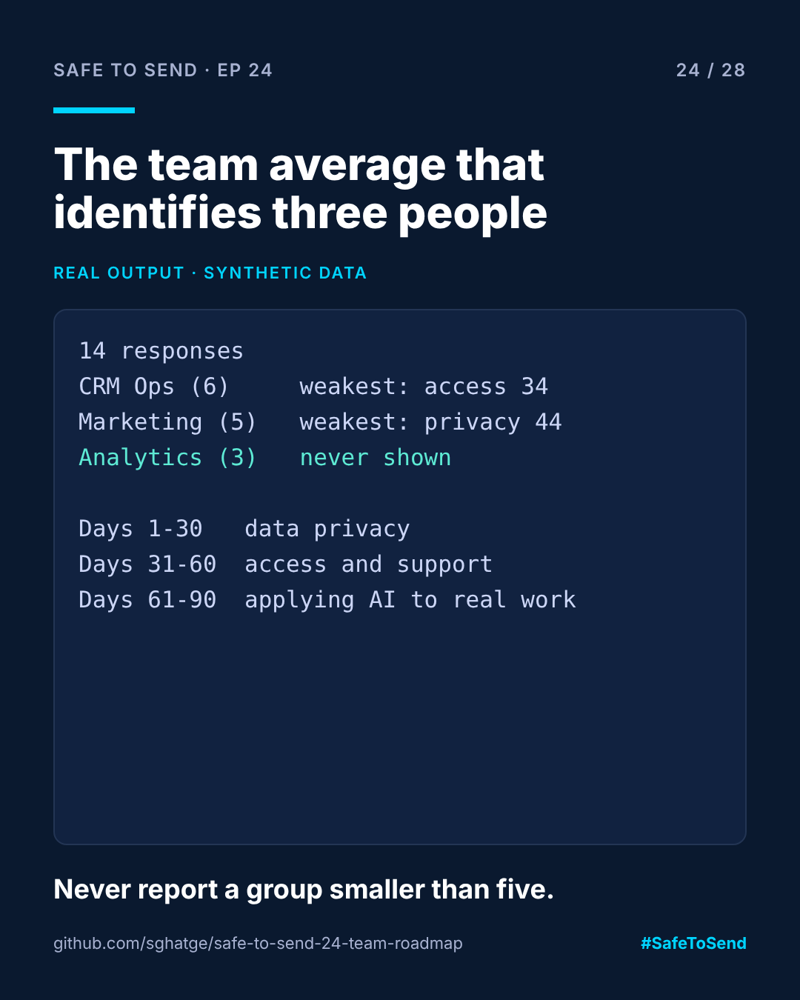

# safe-to-send-24 · From Scores to a 90-Day Plan



**Safe to Send · Episode 24** — a 28-day learn-in-public series on governing AI in CRM operations.

> A readiness score is only useful if it tells a manager what to do on Monday.

## The real-world scenario

Fourteen people across three teams take an AI readiness survey. The manager now has a spreadsheet of numbers, a vague sense that "skills are low", and a privacy problem: the Analytics team is three people, so any "Analytics average" identifies them.

## What this does

1. **Protects people.** Any group under 5 is never reported on its own. Small groups are merged or hidden.
2. **Finds the real gaps.** Team averages per dimension, the three lowest, and how often each risk flag appears.
3. **Orders the work.** Common risk flags jump the queue (a data-handling flag in 20%+ of responses puts privacy first), then the biggest gaps.
4. **Writes the plan.** Each gap maps to a concrete intervention for days 1–30, 31–60 and 61–90.

## Run it

```bash
python team_roadmap.py examples/team_results.json
```

The output is Markdown you can paste into a doc or a ticket.

## Real example output

```markdown
# Team AI readiness: 14 responses

| Group | People | Weakest dimension |
|---|---|---|
| CRM Ops | 6 | Access and support (34) |
| Market Marketing | 5 | Data privacy (44) |
| (not shown) | 3 | groups under 5 are never reported |

Biggest team gaps: Access and support (51), Applying AI to real work (58), Prompting and verification (60)
Risk flags: no_approved_tool 2/14, data_handling_risk 3/14

## 90-day plan
- **Days 1-30 · Data privacy:** Data-handling rules on one page, plus an approved tool so nobody needs a workaround
- **Days 31-60 · Access and support:** Approved tool access for everyone, a named go-to person per team
- **Days 61-90 · Applying AI to real work:** Pick 2 real weekly tasks per team and pair on them with AI for 4 weeks
```

## What the example shows

Marketing is the most enthusiastic group and the one carrying the data-handling flags. CRM Ops is careful but under-equipped. Analytics doesn't appear at all, by design. The plan starts with data privacy, not training, because three people pasting customer data into the wrong tool is the risk that matters first.

MIT · [Sangram Ghatge](https://www.linkedin.com/in/sangram-g-2369705b) · #SafeToSend
